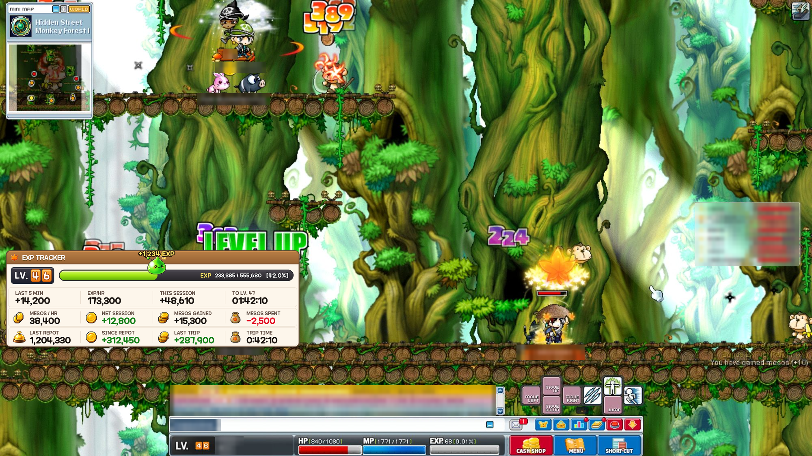
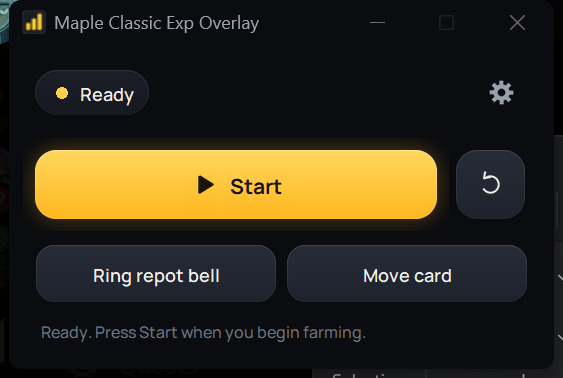
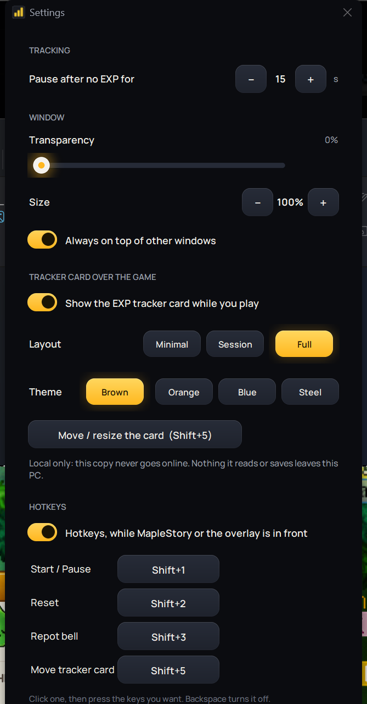
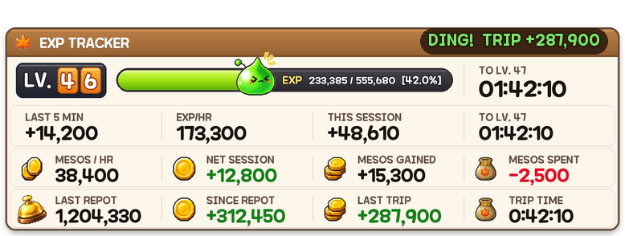
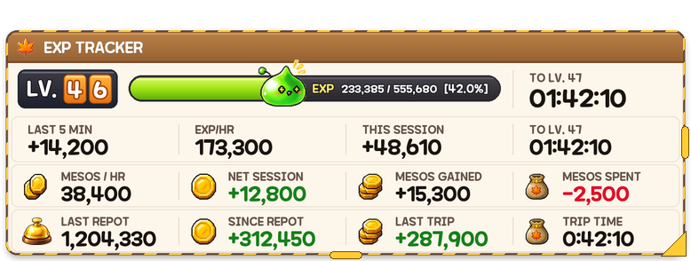
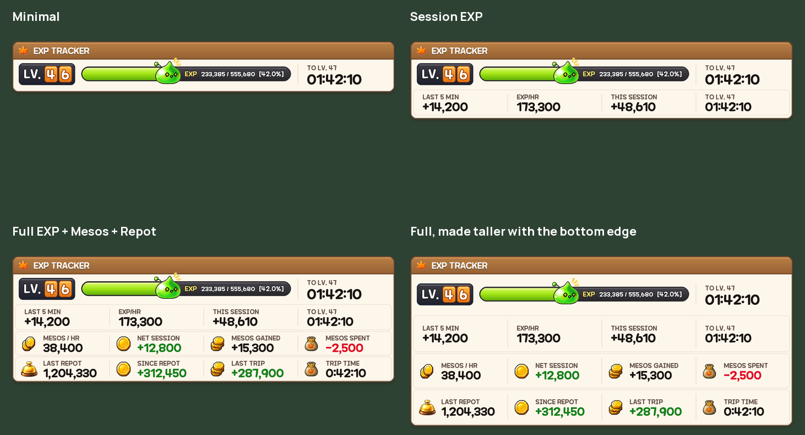
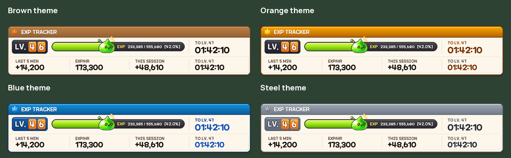
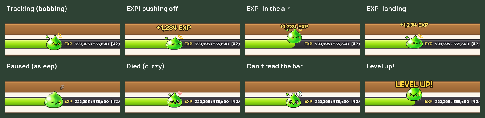

# Maple Exp Overlay

An EXP and mesos tracker for **MapleStory Classic World**, drawn over the game as a card in MapleStory's
own style, with a slime that hops every time you get EXP and a clerk bell for your shop trips.

**Local only:** this copy never goes online. No update checks, no uploads, no website.



## What it does

- **Reads your EXP bar and mesos from the screen.** It never touches the game's files or memory and
  never sends input to the game.
- **Shows a tracker card over the game.** The card shows your level, the EXP gauge, the time to your
  next level, EXP/hr, mesos/hr, and what this session has made.
- **Three layouts:** *Minimal*, *Session EXP*, and *Full*, which adds the mesos and repot rows.
- **Four themes:** Brown, Orange, Blue and Steel.
- **A slime that reacts to what you're doing:**
  - it bobs while you train
  - it hops with "+1,234 EXP" floating up on every gain
  - it hops three times on a level up
  - it falls asleep when you pause
  - it gets dizzy when you die
  - it shows "?" when it can't read your EXP bar
- **The repot bell:** ring it (Shift+3) after each shop trip.
  - The card shows your mesos at the last repot.
  - It also shows what you've made since, live, in green or red.
  - It shows **what the last trip made, exactly**: buying potions and selling loot included, from
    one ring to the next.
- **Calibrates for 5 minutes before showing rates.** EXP/hr, mesos/hr and the time to level wait until
  there's enough to go on, so you don't get wild early numbers.
- **Move and resize the card** (Shift+5):
  - drag it anywhere
  - drag its right edge to make it wider
  - drag its bottom edge to make it taller
  - drag its corner to scale all of it
  - right-click to pick a layout and theme

  It follows the game window if you move that.

## Download and run

1. Go to [**Releases**](../../releases) and download the zip.
2. Unzip it anywhere and keep the whole folder together.
3. Double-click **Maple Classic Exp Overlay.exe**.
   If Windows says "Windows protected your PC", click **More info**, then **Run anyway**: the .exe
   isn't code-signed.
4. Start MapleStory and press **Start**.

| Hotkey  | What it does                                   |
|---------|------------------------------------------------|
| Shift+1 | Start / Pause                                  |
| Shift+2 | Reset                                          |
| Shift+3 | Ring the repot bell                            |
| Shift+5 | Move / resize the card (press again to lock it) |

Hotkeys only work while MapleStory or the overlay is in front. You can change them in Settings.

## Screenshots

| | |
|---|---|
|  |  |
|  |  |





The main window and Settings are screen captures. The card images are drawn by the overlay's own code
and laid over a game screenshot. Other players' names in that screenshot are blurred.

## Privacy: nothing leaves your PC

- **No online features.** The original's update check, run sharing and website links are removed.
- **Connections are refused.** As a backstop, any network connection to anywhere but this PC is
  refused inside the program.
- **Tested for it:**
  - the tests check that no web code exists
  - they check that an internet connection attempt fails
  - the built .exe was watched while running and opened **no** network connections
- **What stays local:** your settings and repot history are in `%APPDATA%\MapleEXP`.
- **Text reading.** Map names are read by the bundled [Tesseract OCR](https://github.com/tesseract-ocr/tesseract),
  which only ever gets screenshots saved in a temporary folder on your PC.

## Build it yourself

```
py -3 -m pip install -r requirements.txt pyinstaller
py -3 build.py
```

Tesseract is needed for the build. Set `TESSERACT_DIR` if it isn't in `C:\Program Files\Tesseract-OCR`.
To run from source instead, use `run.bat`. The tests are in `tests/`; for example,
`py -3 tests/test_logic.py`.

## Credits and license

- **Original app:** based on [Maple Classic Exp Overlay](https://github.com/beanguri/Maple-Classic-Exp-Overlay)
  by **beanguri**, MIT License. The original copyright notice is kept in [LICENSE](LICENSE).
- **This edition:** the local-only changes, the tracker card, the slime, the repot bell and the
  simplified window, by **Javipen**.
- **Maplestory typeface:** © NEXON Korea Corporation, offered free by NEXON. See
  [assets/fonts/MAPLESTORY-FONT.txt](assets/fonts/MAPLESTORY-FONT.txt).
- **Manrope typeface:** SIL Open Font License, see [assets/fonts/OFL.txt](assets/fonts/OFL.txt).
- **Tesseract OCR:** bundled in the download, Apache 2.0.

MapleStory is a trademark of NEXON. This is a fan-made tool, not made by, endorsed by or affiliated
with NEXON.
